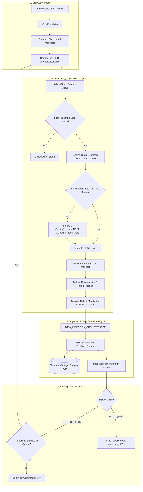

# BICC Intake Controller

[](https://www.python.org/downloads/)
[](https://www.kernel.org/)
[](https://www.teradata.com/)
[](#)

An enterprise intake supervisor and schema synchronizer engineered to bridge asynchronous **Oracle Fusion Cloud BICC (Business Intelligence Cloud Connector)** batch exports with the high-throughput **Data Ingestion Orchestrator** and **Generic TPT Loader**.

`BICC_INTAKE_CONTROLLER` manages multi-batch intake drop zones, enforces chronological FIFO batch execution, performs automated schema drift detection against Teradata Vantage data dictionaries (`DBC.ColumnsV`), dynamically synthesizes NOPI `VARCHAR(4000)` staging DDLs, calculates cryptographic MD5 checksums, vaults raw Oracle manifests, and delegates single-batch loading with strict fail-stop crash protection.

---

## Table of Contents

- [Key Capabilities](#key-capabilities)
- [Architecture & End-to-End Workflow](#architecture--end-to-end-workflow)
- [Directory Layout](#directory-layout)
- [Core Behaviors & Policies](#core-behaviors--policies)
  - [1. FIFO Chronological Batch Ordering](#1-fifo-chronological-batch-ordering)
  - [2. File Stability Sentry (In-Progress Transfers)](#2-file-stability-sentry-in-progress-transfers)
  - [3. Schema Guard & Auto-DDL Synchronization](#3-schema-guard--auto-ddl-synchronization)
  - [4. Manifest Factory & Raw Manifest Vaulting](#4-manifest-factory--raw-manifest-vaulting)
  - [5. Orchestrator Delegation & FAIL_STOP Barrier](#5-orchestrator-delegation--fail_stop-barrier)
- [Configuration Reference (`config.json`)](#configuration-reference-configjson)
- [Entity Mapping Dictionary (`entity_mapping.csv`)](#entity-mapping-dictionary-entity_mappingcsv)
- [Usage & Execution](#usage--execution)
- [Audit Receipts & Logging](#audit-receipts--logging)
- [Troubleshooting & Exit Codes](#troubleshooting--exit-codes)

---

## Key Capabilities

- **Multi-Batch Drop Zone Feeder**: Ingests asynchronous batches from `DROP_ZONE` containing unmanifested uploads or multiple simultaneous batches.
- **Strict FIFO Execution Queue**: Automatically sorts discovered batches in ascending chronological order (oldest extract timestamp first) to maintain state and lineage consistency.
- **Upload Settling Sentry**: Confirms all manifested data files exist, are $>0$ bytes, and have stable file sizes before processing, avoiding partial ingestion during SFTP or cloud transfers.
- **Automated Schema Drift Resolution**: Compares CSV header columns with Teradata `DBC.ColumnsV`. Upon schema evolution or missing tables, automatically creates or updates Teradata staging tables in **`NO PRIMARY INDEX` (`NOPI`)** with all payload columns as **`VARCHAR(4000)`**.
- **Audit Columns Auto-Injection**: Appends `INFA_LAST_REPLICATED TIMESTAMP(0)` and `INFA_BATCH_ID VARCHAR(100)` to all target staging definitions.
- **Cryptographic Manifest Factory**: Computes MD5 checksums across all data files and synthesizes standard `MANIFEST_ORACLE_FUSION_<TIMESTAMP>_<BATCH_ID>.MF` manifests for the Orchestrator.
- **Regulatory Manifest Vault**: Preserves pristine raw BICC manifests in `DROP_ZONE/ARCHIVE/<BATCH_ID>/` alongside a detailed JSON intake audit receipt (`intake_receipt.json`).
- **FAIL_STOP Barrier**: Halts immediately on the first sign of worker, TPT, or downstream dbt transformation failure, preventing cascade corruption.

---

## Architecture & End-to-End Workflow



---

## Directory Layout

```text
BICC_INTAKE_CONTROLLER/
├── feeder.py                      # Main supervisor entrypoint and queue coordinator
├── config_template.json           # Template configuration file
├── entity_mapping.csv             # Entity mapping rules (SOURCE='ORACLE_FUSION')
├── README.md                      # Technical repository documentation
├── logs/                          # Dedicated execution logs (feeder_<TIMESTAMP>.log)
└── lib/
    ├── scanner.py                 # DROP_ZONE scanner, manifest parser & stability sentry
    ├── schema_guard.py            # DBC.ColumnsV introspector & Auto-DDL engine
    ├── manifest_factory.py        # Checksum calculator, manifest factory & vault archiver
    └── orchestrator_bridge.py     # Subprocess runner with real-time log streaming
```

---

## Core Behaviors & Policies

### 1. FIFO Chronological Batch Ordering
Oracle Fusion exports transactional data (e.g., invoices, purchase orders) with sequential dependencies. The scanner parses manifest filenames and timestamps, queuing batches in strict **ascending chronological order (FIFO - oldest to newest)**. This ensures that historical changes are staged and transformed in sequence.

### 2. File Stability Sentry (In-Progress Transfers)
To prevent processing partially transferred files (e.g., in-flight SFTP or cloud synchronization):
1. Verifies that all files declared in the manifest exist in `DROP_ZONE`.
2. Verifies that all files are $>0$ bytes.
3. Observes file sizes across a settling window (configurable, default 5s). If file sizes change, processing is postponed.

### 3. Schema Guard & Auto-DDL Synchronization
Oracle Cloud quarterly updates may introduce new columns to BICC PVOs. The Schema Guard:
1. Reads line 1 of the entity CSV file (chunk 1 if multi-chunk).
2. Sanitizes column names into Teradata-compatible uppercase identifiers.
3. Queries Teradata `DBC.ColumnsV` to retrieve existing staging column definitions (excluding audit columns).
4. If a schema drift is detected (or the table does not exist):
   - Drops the existing table: `DROP TABLE <target_db>.<target_table>;`
   - Recreates the staging table:
     ```sql
     CREATE MULTISET TABLE <target_db>.<target_table> ,NO FALLBACK ,
          NO BEFORE JOURNAL,
          NO AFTER JOURNAL,
          CHECKSUM = DEFAULT,
          DEFAULT MERGEBLOCKRATIO
          (
             <COL_1> VARCHAR(4000) CHARACTER SET UNICODE NOT CASESPECIFIC,
             ...
             <COL_N> VARCHAR(4000) CHARACTER SET UNICODE NOT CASESPECIFIC,
             INFA_LAST_REPLICATED TIMESTAMP(0),
             INFA_BATCH_ID VARCHAR(100) CHARACTER SET UNICODE NOT CASESPECIFIC
          )
     NO PRIMARY INDEX;
     ```
   - Staging payload columns are typed as `VARCHAR(4000)` to ensure a raw landing buffer with zero data conversion failures. High-speed `NOPI` streaming is maintained.

### 4. Manifest Factory & Raw Manifest Vaulting
- Computes MD5 hashes for all data files.
- Generates an orchestrator-compliant manifest in `LANDING_ZONE`:
  `MANIFEST_ORACLE_FUSION_<EXTRACT_TIMESTAMP>_<BATCH_ID>.MF`
- Moves the raw BICC manifest to `DROP_ZONE/ARCHIVE/<EXTRACT_TIMESTAMP>_<BATCH_ID>/` along with a detailed JSON intake receipt (`intake_receipt.json`) certifying file sizes and calculated checksums.

### 5. Orchestrator Delegation & FAIL_STOP Barrier
- Atomically moves data files into `LANDING_ZONE`.
- Synchronously launches `DATA_INGESTION_ORCHESTRATOR` and streams all child worker logs.
- If the Orchestrator, TPT loader, or downstream dbt models return any non-zero exit code (`RC > 0`):
  - Enforces the **`FAIL_STOP`** barrier.
  - Halts execution immediately (`sys.exit(1)`).
  - Preserves remaining unprocessed batches in `DROP_ZONE` for operational triage.

---

## Configuration Reference (`config.json`)

```json
{
  "feeder": {
    "drop_zone": "/data/drop_zone",
    "raw_manifest_archive": "/data/drop_zone/archive",
    "logs_dir": "logs",
    "batch_selection_policy": "FIFO_ALL",
    "on_batch_failure": "abort",
    "file_stability_window_seconds": 5,
    "source_system_code": "ORACLE_FUSION"
  },
  "schema_guard": {
    "auto_migrate_ddl": true,
    "default_column_type": "VARCHAR(4000)",
    "character_set": "UNICODE",
    "target_database": "globalmart_stg",
    "entity_mapping_file": "entity_mapping.csv"
  },
  "orchestrator": {
    "orchestrator_dir": "/opt/orchestrator",
    "config_file": "config.json",
    "landing_zone": "/data/orchestrator/landing_zone",
    "python_executable": "python"
  },
  "teradata": {
    "host": "ms-env.teradata.com",
    "user": "demo_user",
    "password": "<YourPassword_or_Wallet>",
    "logmech": "TD2"
  }
}
```

---

## Entity Mapping Dictionary (`entity_mapping.csv`)

```csv
SOURCE,TARGET_TABLE,FILE_SIGNATURE,EXTENSION
ORACLE_FUSION,ERP_AP_INVOICE_HEADER,invoiceheaderextractpvo,.csv
ORACLE_FUSION,ERP_AP_INVOICE_LINES,invoicelinesextractpvo,.csv
ORACLE_FUSION,ERP_AP_INVOICE_DIST,invoicedistributionextractpvo,.csv
ORACLE_FUSION,ERP_PO_HEADERS,poheadersextractpvo,.csv
ORACLE_FUSION,ERP_PO_LINES,polinesextractpvo,.csv
ORACLE_FUSION,ERP_USER,userpvo,.csv
```

---

## Usage & Execution

Launch the supervisor controller:
```bash
python feeder.py --config config.json
```

### Automation via Crontab
```bash
*/15 * * * * cd /opt/bicc_intake && /usr/bin/python3 feeder.py --config config.json >> /var/log/feeder_cron.log 2>&1
```

If `DROP_ZONE` contains no batches, the process exits cleanly with Return Code `0`.

---

## Audit Receipts & Logging

### Execution Logs
Generated automatically in `logs/`:
```text
logs/feeder_<TIMESTAMP>.log
```

### Vaulted Intake Receipt (`intake_receipt.json`)
Stored alongside the raw manifest in `DROP_ZONE/ARCHIVE/<EXTRACT_TIMESTAMP>_<BATCH_ID>/`:
```json
{
  "batch_id": "1005",
  "source": "ORACLE_FUSION",
  "extract_timestamp": "20261012_140000",
  "intake_timestamp": "2026-10-12 14:45:00",
  "raw_manifest_vaulted": "MANIFEST-batch1005-.MF",
  "payload": [
    {
      "filename": "file_invoiceheaderextractpvo-batch1005-.csv",
      "filesize_bytes": 1048576,
      "md5": "3a742629d08dcb9ed4c588929e96e080",
      "target_table": "ERP_AP_INVOICE_HEADER",
      "schema_action": "IDENTICAL"
    }
  ]
}
```

---

## Troubleshooting & Exit Codes

| Exit Code | Meaning | Action |
| :---: | :--- | :--- |
| `0` | All batches processed successfully, or `DROP_ZONE` is empty (`IDLE`). | Normal operation. |
| `1` | Payload stability failure, schema DDL error, or Orchestrator failure (`FAIL_STOP`). | Inspect `logs/feeder_<TIMESTAMP>.log` and Teradata `BATCH_TASKS` table. |
