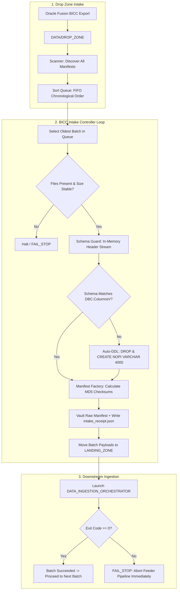

# BICC Intake Controller

[](https://www.python.org/downloads/)
[](https://www.kernel.org/)
[](https://www.teradata.com/)
[](#)

An enterprise intake supervisor and schema synchronizer engineered to bridge asynchronous **Oracle Fusion Cloud BICC (Business Intelligence Cloud Connector)** batch exports with the high-throughput **Data Ingestion Orchestrator** and **Generic TPT Loader**.

`BICC_INTAKE_CONTROLLER` manages multi-batch intake drop zones, enforces chronological FIFO batch execution, performs automated schema drift detection against Teradata Vantage data dictionaries (`DBC.ColumnsV`), dynamically synthesizes NOPI `VARCHAR(4000)` staging DDLs, calculates cryptographic MD5 checksums, vaults raw Oracle manifests, and delegates single-batch loading with strict fail-stop crash protection.

---

## 📚 Complete Documentation Suite

Comprehensive operational, technical, and testing manuals are available in the [`docs/`](docs/) directory:

- 📖 **[User How-To & Configuration Guide](docs/01_user_how_to_guide.md)**: Command-line syntax, complete `config.json` reference, log inspection, and troubleshooting runbooks.
- 📐 **[Functional Specification](docs/02_functional_specification.md)**: Plain-English architecture, FIFO queue sequencing, in-memory zero-disk streaming, and Auto-DDL contracts.
- ⚙️ **[Technical Manual & Function Inventory](docs/03_technical_manual_and_inventory.md)**: Internal module structure, function signatures, DBC catalog queries, and subprocess delegation.
- 🧪 **[Testing, Validation & QA Guide](docs/04_testing_and_qa_guide.md)**: Test matrices, synthetic dataset synthesis (CSV, ZIP, GZ, PECSV), and automated regression test harnesses.

---

## Table of Contents

- [Key Capabilities](#key-capabilities)
- [Architecture & End-to-End Workflow](#architecture--end-to-end-workflow)
- [Directory Layout](#directory-layout)
- [Core Behaviors & Policies](#core-behaviors--policies)
  - [1. FIFO Chronological Batch Ordering](#1-fifo-chronological-batch-ordering)
  - [2. File Stability Sentry (In-Progress Transfers)](#2-file-stability-sentry-in-progress-transfers)
  - [3. Schema Guard & Auto-DDL Synchronization](#3-schema-guard--auto-ddl-synchronization)
  - [4. Manifest Factory & Raw Manifest Vaulting](#4-manifest-factory--raw-manifest-vaulting)
  - [5. Orchestrator Delegation & FAIL_STOP Barrier](#5-orchestrator-delegation--fail_stop-barrier)
- [Configuration Reference (`config.json`)](#configuration-reference-configjson)
- [Entity Mapping Dictionary (`entity_mapping.csv`)](#entity-mapping-dictionary-entity_mappingcsv)
- [Usage & Execution](#usage--execution)
- [Audit Receipts & Logging](#audit-receipts--logging)
- [Troubleshooting & Exit Codes](#troubleshooting--exit-codes)

---

## Key Capabilities

- **Multi-Batch Drop Zone Feeder**: Ingests asynchronous batches from `DROP_ZONE` containing unmanifested uploads or multiple simultaneous batches.
- **Strict FIFO Execution Queue**: Automatically sorts discovered batches in ascending chronological order (oldest extract timestamp first) to maintain state and lineage consistency.
- **Upload Settling Sentry**: Confirms all manifested data files exist, are $>0$ bytes, and have stable file sizes before processing, avoiding partial ingestion during SFTP or cloud transfers.
- **Automated Schema Drift Resolution**: Compares CSV header columns with Teradata `DBC.ColumnsV`. Upon schema evolution or missing tables, automatically creates or updates Teradata staging tables in **`NO PRIMARY INDEX` (`NOPI`)** with all payload columns as **`VARCHAR(4000) UNICODE NOT CASESPECIFIC`**.
- **Audit Columns Auto-Injection**: Appends `INFA_LAST_REPLICATED TIMESTAMP(0)` and `INFA_BATCH_ID VARCHAR(100)` to all target staging definitions.
- **Cryptographic Manifest Factory**: Computes MD5 checksums across all data files and synthesizes standard `MANIFEST_ORACLE_FUSION_<TIMESTAMP>_<BATCH_ID>.MF` manifests for the Orchestrator.
- **Regulatory Manifest Vault**: Preserves pristine raw BICC manifests in `DROP_ZONE/ARCHIVE/<BATCH_ID>/` alongside a detailed JSON intake audit receipt (`intake_receipt.json`).
- **FAIL_STOP Barrier**: Halts immediately on the first sign of worker, TPT, or downstream transformation failure, preventing cascade corruption.

---

## Architecture & End-to-End Workflow



---

## Configuration Reference (`config.json`)

The controller configuration uses portable relative paths and environment variable interpolation:

```json
{
  "feeder": {
    "drop_zone": "../../DATA/DROP_ZONE",
    "raw_manifest_archive": "../../DATA/DROP_ZONE/ARCHIVE",
    "logs_dir": "../../LOGS",
    "batch_selection_policy": "FIFO_ALL",
    "on_batch_failure": "abort",
    "file_stability_window_seconds": 3,
    "source_system_code": "ORACLE_FUSION"
  },
  "schema_guard": {
    "auto_migrate_ddl": true,
    "default_column_type": "VARCHAR(4000)",
    "character_set": "UNICODE",
    "target_database": "${TDENV}SIDFINSTG",
    "entity_mapping_file": "../../CONFIG/entity_mapping.csv"
  },
  "orchestrator": {
    "orchestrator_dir": "../DATA_INGESTION_ORCHESTRATOR",
    "config_file": "config.json",
    "landing_zone": "../../DATA/LANDING_ZONE",
    "python_executable": "python3"
  },
  "teradata": {
    "host": "${TDPID}",
    "user": "${TDENV}${SID_ADM_USER}",
    "logmech": "TD2"
  }
}
```

---

## Entity Mapping Dictionary (`entity_mapping.csv`)

The mapping file defines how source filenames map to Teradata staging tables, including support for `.csv`, `.zip`, `.gz`, and `.pecsv` (active keys):

```csv
SOURCE,TARGET_TABLE,FILE_SIGNATURE,EXTENSION,INNER_EXTENSION
ORACLE_FUSION,ERP_MSH_INVOICE_HEADER,invoiceheaderextractpvo,".csv,.zip,.gz,.csv.gz",.csv
ORACLE_FUSION,ERP_MSH_INVOICE_HEADER_AK,invoiceheaderextractpvo,".pecsv,.zip,.gz,.pecsv.gz",.pecsv
ORACLE_FUSION,ERP_MSH_USER,userpvo,".csv,.zip,.gz,.csv.gz",.csv
ORACLE_FUSION,ERP_MSH_USER_AK,userpvo,".pecsv,.zip,.gz,.pecsv.gz",.pecsv
```

---

## Usage & Execution

Launch the supervisor controller:
```bash
python3 feeder.py --config config.json
```

If `DROP_ZONE` contains no batches, the process exits cleanly with Return Code `0`.

---

## Troubleshooting & Exit Codes

| Exit Code | Meaning | Action |
| :---: | :--- | :--- |
| `0` | All batches processed successfully, or `DROP_ZONE` is empty (`IDLE`). | Normal operation. |
| `1` | Payload stability failure, schema DDL error, or Orchestrator failure (`FAIL_STOP`). | Inspect `LOGS/feeder_<TIMESTAMP>.log` and Teradata `BATCH_TASKS` table. |

For detailed failure scenarios and step-by-step remediation procedures, consult **[docs/01_user_how_to_guide.md](docs/01_user_how_to_guide.md)**.
