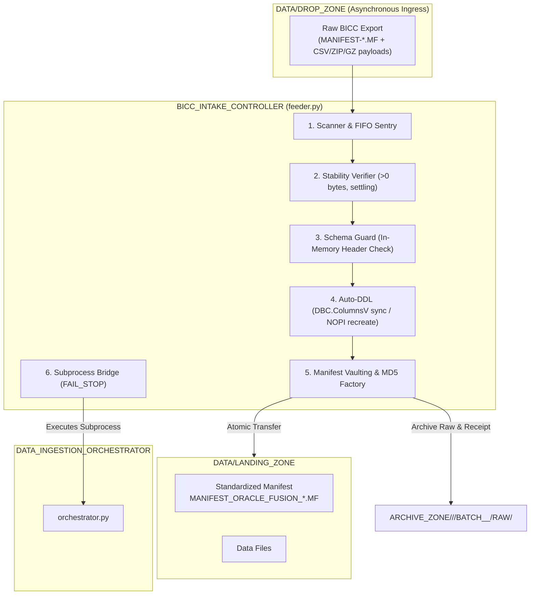

# BICC_INTAKE_CONTROLLER - User How-To & Configuration Guide

## 1. Overview & Operational Role

The **BICC_INTAKE_CONTROLLER** (`feeder.py`) is the Tier-1 supervisor of the `DATA_LOADER` ingestion suite. It governs the ingress of raw, asynchronous data exports generated by **Oracle Fusion Cloud BICC (Business Intelligence Cloud Connector)**.



### Core Responsibilities
1. **FIFO Ingress Queueing**: Automatically detects multi-batch arrivals in `DROP_ZONE/<SOURCE>/` and executes them strictly in ascending chronological order (oldest extract first) to preserve temporal data integrity. Files deposited at the root of `DROP_ZONE/` are strictly ignored to prevent cross-source data corruption.
2. **File Stability Sentry**: Verifies that files are non-empty (>0 bytes) and that file sizes do not fluctuate during a configurable settling window (guarantees external SFTP/cloud copy completion).
3. **Automated Schema Guard**: Detects schema drift in source extracts without extracting compressed files to disk (streams headers directly from `.zip` / `.gz` archives) and auto-recreates target Teradata staging tables in `NOPI` `VARCHAR(4000)` format when needed.
4. **Standardized Cryptographic Manifest**: Calculates MD5 sums on data payloads, vaults the pristine upstream raw manifest with a JSON intake receipt (`RECEIPT_<SOURCE>_<TS>_<BATCH_ID>.json`), and moves the batch atomically into `LANDING_ZONE/<SOURCE>/`.
5. **FAIL_STOP Delegation**: Synchronously invokes `DATA_INGESTION_ORCHESTRATOR` and aborts immediately if any downstream step fails.

---

## 2. Prerequisites & Environment Setup

### 2.1 Runtime Dependencies
- **Operating System**: Linux / Unix POSIX runtime (e.g. Red Hat Enterprise Linux 7/8/9, Debian/Ubuntu).
- **Python**: Python 3.8+ (tested and production-ready on Python 3.8, 3.9, 3.11, 3.12).
- **Python Libraries**: `teradatasql` (official Teradata Python driver).

```bash
# Verify Python runtime
python3 --version

# Verify teradatasql driver presence
python3 -c "import teradatasql; print('teradatasql OK, version:', teradatasql.__version__)"
```

### 2.2 Shell Environment Variables
In the target Unix production/test environment, the user profile (`~/.profile`) defines and exports standard environment parameters:

```bash
export TDENV="DEV0"
export ENV="DEV"
export USER_CHAPEAU="DEVADM"
export TDPID="tdadev"
export SID_ADM_USER="SIDFINADM"
export TDADEV="2"
export LANG="C"
```

The controller dynamically expands `${TDENV}`, `${TDPID}`, and `${SID_ADM_USER}` when resolving configurations.

### 2.3 Teradata Authentication
The controller uses one of two authentication methods:
1. **Property Key/Pass Files (Production Default)**:
   Stored in `~/.dbt/` or `$DBT_PROFILE_DIR`:
   - `${TDENV}${SID_ADM_USER}_Key.properties`
   - `${TDENV}${SID_ADM_USER}_Pass.properties`
   Connection string syntax: `ENCRYPTED_PASSWORD(file:<key>,file:<pass>)`
2. **Environment Variable Override (`TD_PASSWORD`)**:
   Used in isolated developer sandboxes where wallet or property files are not configured:
   ```bash
   export TD_PASSWORD="YourPasswordHere"
   ```

---

## 3. Command-Line Syntax & Execution

### 3.1 Invocation Syntax
```bash
python3 feeder.py --config <path_to_config.json> [--skip-post-tasks] [--source <SOURCE>]
```

| Parameter | Required | Type | Description |
|---|---|---|---|
| `--config` | **Yes** | String | Path to the JSON configuration file (relative or absolute). |
| `--skip-post-tasks` | No | Flag | Bypasses downstream post-ingestion tasks (both source-specific and global dbt/analytics models). Useful for re-inits or maintenance loads. |
| `--source` | No | String | Overrides the source system code (e.g. `ORACLE_FUSION`, `CRM`) and routes file ingress to partitioned subdirectories (`DROP_ZONE/<SOURCE>/`). |

### 3.2 Standard Execution Examples

#### Example 1: Standard Supervised Batch Run
Run the controller using the default deployment configuration:
```bash
cd /sg/local/sid/home/Dsidadm/DATA_LOADER/PROCESSING_TOOLS/BICC_INTAKE_CONTROLLER
python3 feeder.py --config config.json
```

#### Example 2: Selective / Maintenance Ingestion with Post-Tasks Skipped
Load incoming tables without triggering downstream dbt transformations:
```bash
python3 feeder.py --config config.json --skip-post-tasks
```

#### Example 3: Multi-Source Partitioned Ingestion
Process only extracts originating from a specific source partition:
```bash
python3 feeder.py --config config.json --source CRM
```

#### Example 4: Scheduled Automation via Cron
```cron
# Run BICC Intake Controller every 15 minutes
*/15 * * * * cd /sg/local/sid/home/Dsidadm/DATA_LOADER/PROCESSING_TOOLS/BICC_INTAKE_CONTROLLER && python3 feeder.py --config config.json >> /sg/local/sid/home/Dsidadm/DATA_LOADER/LOGS/cron_feeder.log 2>&1
```

---

## 4. Configuration Reference (`config.json`)

Configuration files support environment variable expansion (e.g. `${TDENV}`, `${TDPID}`, `${SID_ADM_USER}`). Paths can be specified as absolute paths or relative to the directory containing `config.json`.

### 4.1 Production Configuration Schema
```json
{
  "feeder": {
    "drop_zone": "../../DATA/DROP_ZONE",
    "raw_manifest_archive": "../../DATA/ARCHIVE_ZONE",
    "logs_dir": "../../LOGS",
    "batch_selection_policy": "FIFO_ALL",
    "on_batch_failure": "abort",
    "file_stability_window_seconds": 3,
    "source_system_code": "ORACLE_FUSION",
    "post_ingestion_tasks": [
      {
        "type": "shell",
        "command": "echo 'Post-task specific to BICC / ORACLE_FUSION completed for batch $CURRENT_BATCH_ID'"
      }
    ]
  },
  "schema_guard": {
    "auto_migrate_ddl": true,
    "default_column_type": "VARCHAR(4000)",
    "character_set": "UNICODE",
    "target_database": "${TDENV}SIDFINSTG",
    "entity_mapping_file": "../../CONFIG/entity_mapping.csv"
  },
  "orchestrator": {
    "orchestrator_dir": "../DATA_INGESTION_ORCHESTRATOR",
    "config_file": "config.json",
    "landing_zone": "../../DATA/LANDING_ZONE",
    "python_executable": "python3"
  },
  "teradata": {
    "host": "${TDPID}",
    "user": "${TDENV}${SID_ADM_USER}",
    "logmech": "TD2"
  }
}
```

### 4.2 Parameter Specification

#### `feeder` Block
| Parameter | Type | Default | Description |
|---|---|---|---|
| `drop_zone` | String | `../../DATA/DROP_ZONE` | Path to upstream arrival base directory. Feeder automatically partitions to `DROP_ZONE/<SOURCE>/` (e.g. `DROP_ZONE/ORACLE_FUSION/`). Files dropped at the root of `DROP_ZONE/` are strictly ignored. |
| `raw_manifest_archive` | String | `../../DATA/ARCHIVE_ZONE` | Base archive directory. Raw manifests and intake receipts are vaulted inside the Batch Capsule: `ARCHIVE_ZONE/<SOURCE>/<YYYY-MM>/BATCH_<ID>_<TS>/RAW/`. |
| `logs_dir` | String | `../../LOGS` | Central directory where execution logs are written, automatically partitioned by source (`LOGS/<SOURCE>/`). |
| `batch_selection_policy` | String | `FIFO_ALL` | Policy for processing multi-batch queues. Currently `FIFO_ALL` processes all detected batches from oldest to newest. |
| `on_batch_failure` | String | `abort` | Policy on downstream error: `abort` applies `FAIL_STOP`, exiting immediately. |
| `file_stability_window_seconds` | Integer | `3` | Number of seconds to wait during stability sentry checking before confirming file size constancy. |
| `source_system_code` | String | `ORACLE_FUSION` | Identifier for the source ERP system. |
| `post_ingestion_tasks` | List[Dict] | `[]` | Optional list of source-specific post-ingestion tasks (e.g. shell scripts, dbt runs) to delegate to the Orchestrator. |

#### `schema_guard` Block
| Parameter | Type | Default | Description |
|---|---|---|---|
| `auto_migrate_ddl` | Boolean | `true` | If `true`, recreates target table in `NOPI` format upon schema drift or missing table. |
| `default_column_type` | String | `VARCHAR(4000)` | Teradata datatype applied to all payload columns in auto-generated DDL. |
| `character_set` | String | `UNICODE` | Teradata character set applied (`UNICODE NOT CASESPECIFIC`). |
| `target_database` | String | `${TDENV}SIDFINSTG` | Teradata staging database hosting physical staging tables. |
| `entity_mapping_file` | String | `../../CONFIG/entity_mapping.csv` | Path to entity routing mapping CSV. |

#### `orchestrator` Block
| Parameter | Type | Default | Description |
|---|---|---|---|
| `orchestrator_dir` | String | `../DATA_INGESTION_ORCHESTRATOR` | Location of the Orchestrator component. |
| `config_file` | String | `config.json` | Configuration file to pass to `orchestrator.py`. |
| `landing_zone` | String | `../../DATA/LANDING_ZONE` | Target landing zone for handoff to Orchestrator. |
| `python_executable` | String | `python3` | Path or name of Python binary to spawn Orchestrator. |

#### `teradata` Block
| Parameter | Type | Default | Description |
|---|---|---|---|
| `host` | String | `${TDPID}` | Teradata gateway host / COP name. |
| `user` | String | `${TDENV}${SID_ADM_USER}` | Teradata logon user name. |
| `logmech` | String | `TD2` | Authentication mechanism (`TD2` or `LDAP`). |
| `key_file` | String (Opt) | None | Explicit path to Key properties file. |
| `pass_file` | String (Opt) | None | Explicit path to Pass properties file. |

---

## 5. Monitoring & Operational Inspection

### 5.1 Log Files & Naming Convention
Logs are written simultaneously to standard output (`stdout`) and to timestamped log files in `logs_dir/<SOURCE>/`:
```
../../LOGS/<SOURCE>/LOG_FEEDER_<SOURCE>_<EXEC_TS>.log
```
Example: `../../LOGS/ORACLE_FUSION/LOG_FEEDER_ORACLE_FUSION_20261016_173927.log`

### 5.2 Interpreting Controller Logs
A typical successful execution displays:
```text
2026-10-16 17:39:27 | INFO     | BICC_INTAKE_CONTROLLER | Initialized BICC Intake Controller log file: '/sg/local/sid/home/Dsidadm/DATA_LOADER/LOGS/ORACLE_FUSION/LOG_FEEDER_ORACLE_FUSION_20261016_173927.log'
2026-10-16 17:39:27 | INFO     | BICC_INTAKE_CONTROLLER | ======================================================================
2026-10-16 17:39:27 | INFO     | BICC_INTAKE_CONTROLLER | STARTING BICC INTAKE CONTROLLER - SUPERVISOR RUN (Source: ORACLE_FUSION)
2026-10-16 17:39:27 | INFO     | BICC_INTAKE_CONTROLLER | ======================================================================
2026-10-16 17:39:27 | INFO     | BICC_INTAKE_CONTROLLER | Drop Zone: /sg/local/sid/home/Dsidadm/DATA_LOADER/DATA/DROP_ZONE/ORACLE_FUSION
2026-10-16 17:39:27 | INFO     | BICC_INTAKE_CONTROLLER | Discovered 1 batch(es) in drop zone. Processing queue in FIFO order (oldest to newest):
2026-10-16 17:39:27 | INFO     | BICC_INTAKE_CONTROLLER |   [1/1] Batch ID: 9001, Extract TS: 20261016_100000, Files: 1
2026-10-16 17:39:28 | INFO     | BICC_INTAKE_CONTROLLER | Connected successfully to Teradata Vantage for schema introspection.
2026-10-16 17:39:28 | INFO     | BICC_INTAKE_CONTROLLER | [ERP_USER] Schema is identical (85 columns). No DDL modification needed.
2026-10-16 17:39:29 | INFO     | BICC_INTAKE_CONTROLLER | Vaulted original manifest 'MANIFEST_ORACLE_FUSION_20261016_100000_9001.MF' and intake receipt to '/sg/.../DATA/ARCHIVE_ZONE/ORACLE_FUSION/2026-10/BATCH_9001_20261016_100000/RAW'.
2026-10-16 17:39:29 | INFO     | BICC_INTAKE_CONTROLLER | Created standardized manifest: '/sg/.../DATA/LANDING_ZONE/ORACLE_FUSION/MANIFEST_ORACLE_FUSION_20261016_100000_9001.MF' with 1 file entries.
2026-10-16 17:39:29 | INFO     | BICC_INTAKE_CONTROLLER | Transferred 1 data files to Orchestrator landing zone.
2026-10-16 17:39:29 | INFO     | BICC_INTAKE_CONTROLLER | Delegating execution of batch 9001 to DATA_INGESTION_ORCHESTRATOR...
... [Orchestrator live stream] ...
2026-10-16 17:39:56 | INFO     | BICC_INTAKE_CONTROLLER | [SUCCESS] Batch 9001 ingested, verified and transformed successfully.
2026-10-16 17:39:56 | INFO     | BICC_INTAKE_CONTROLLER | ALL 1 BATCHES PROCESSED WITH 100% SUCCESS!
```

---

## 6. Troubleshooting Runbook

### Failure Mode 1: Teradata Connection Refused / Invalid Logon
- **Symptom**:
  ```text
  FATAL: Database connection failed: [Teradata Database] [Error 8017] The UserId, Password or Account is invalid.
  ```
- **Root Cause**: Missing or invalid credentials in `.dbt/` property files or `$TD_PASSWORD`.
- **Diagnostic Commands**:
  ```bash
  # Check if DBT property files exist for user
  ls -la ~/.dbt/${TDENV}${SID_ADM_USER}_*.properties
  
  # Test direct python connection
  python3 -c "import teradatasql, os; conn=teradatasql.connect(host=os.environ['TDPID'], user=os.environ['TDENV']+os.environ['SID_ADM_USER'], password=os.environ.get('TD_PASSWORD', 'test')); print('Connected')"
  ```
- **Resolution**:
  1. Verify the current password stored in tdwallet or the key/pass files.
  2. Regenerate key and password property files if required.
  3. Ensure `${TDENV}` and `${SID_ADM_USER}` are set in the executing shell session.

---

### Failure Mode 2: Unstable File / Transfer in Progress
- **Symptom**:
  ```text
  Payload stability check failed for batch 000000012: File 'file_invoiceheaderextractpvo-...zip' size changed during settling window (1048576 -> 2097152 bytes). Upload in progress.
  Halting pipeline under FAIL_STOP policy to prevent corrupt ingestion.
  ```
- **Root Cause**: Upstream BICC transfer or SFTP process is still writing to `DROP_ZONE`.
- **Diagnostic Commands**:
  ```bash
  # Check if a process has an open write lock on the file
  fuser -v /sg/local/sid/home/Dsidadm/DATA_LOADER/DATA/DROP_ZONE/*
  
  # Check file size change over 5 seconds
  ls -l /sg/local/sid/home/Dsidadm/DATA_LOADER/DATA/DROP_ZONE/
  sleep 5
  ls -l /sg/local/sid/home/Dsidadm/DATA_LOADER/DATA/DROP_ZONE/
  ```
- **Resolution**:
  - The controller automatically protects against this! No manual file repair is needed.
  - Wait for the upstream upload to finish. The next invocation of `feeder.py` will detect that file sizes have stabilized and will process the batch normally.

---

### Failure Mode 3: Unrecognized Entity in `entity_mapping.csv`
- **Symptom**:
  ```text
  FATAL: File 'file_customentityextractpvo-batch1001-20261015.csv' does not match any recognized entity in '../../CONFIG/entity_mapping.csv'.
  ```
- **Root Cause**: Upstream BICC exported a new extract whose signature is not registered in `entity_mapping.csv`.
- **Diagnostic Commands**:
  ```bash
  cat /sg/local/sid/home/Dsidadm/DATA_LOADER/CONFIG/entity_mapping.csv
  ```
- **Resolution**:
  1. Add a new row to `entity_mapping.csv` mapping the signature to the target table:
     ```csv
     ORACLE_FUSION,ERP_CUSTOM_ENTITY,customentityextractpvo,".csv,.zip,.gz",.csv
     ```
  2. Re-run `feeder.py --config config.json`. Schema Guard will automatically inspect the header and create `ERP_CUSTOM_ENTITY` in Teradata.

---

### Failure Mode 4: In-Flight Crash Recovery Triggered
- **Symptom**:
  ```text
  In-flight batch detected in LOADING_ZONE (MANIFEST_ORACLE_FUSION_20261015_120011_000000011.MF). Resuming Orchestrator delegation...
  ```
- **Root Cause**: A previous run terminated abruptly (e.g. system kill, server reboot) after the batch moved to `LOADING_ZONE`.
- **Behavior**: The controller detects the in-flight manifest in `LOADING_ZONE` upon startup, bypasses re-scanning, and immediately resumes the Orchestrator to finish processing and archiving the in-flight batch before touching new files.
