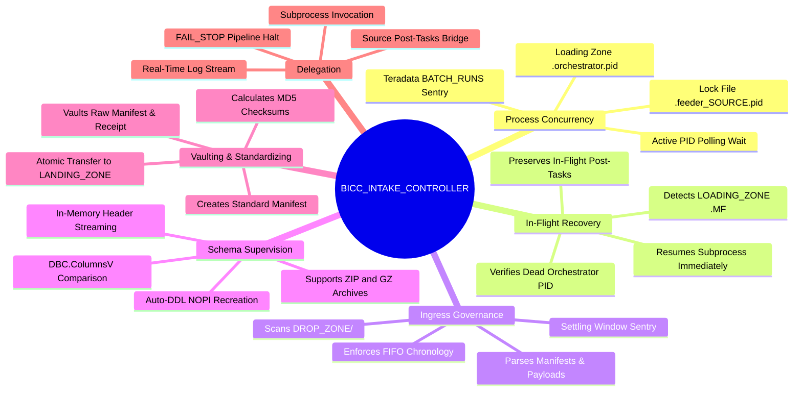
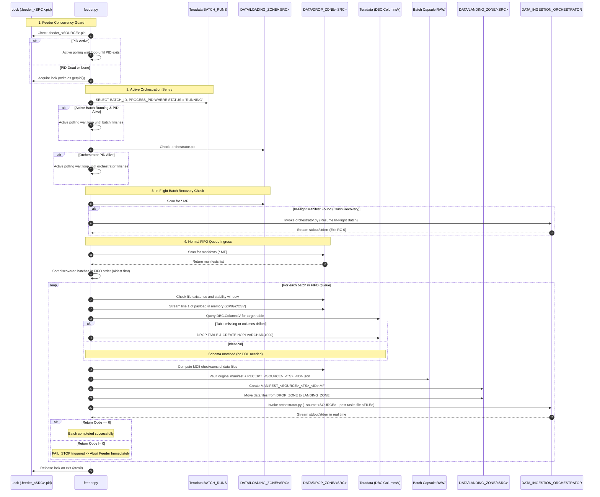

# BICC_INTAKE_CONTROLLER - Functional Specification

## 1. Business & Functional Objective

The **BICC_INTAKE_CONTROLLER** serves as the intake gateway and schema supervisor for the **DATA_LOADER** flat-file ELT ecosystem feeding Teradata Vantage from **Oracle Fusion Cloud BICC (Business Intelligence Cloud Connector)** extracts.

### Upstream Context
Oracle Fusion Cloud BICC exports data asynchronously in batches consisting of:
- A manifest metadata file indicating the export timestamp and declared payload files.
- One or more data extract files (formatted as `.csv`, `.pecsv`, `.zip`, or `.gz`), which may be chunked into multiple parts.
- Active Keys extracts (`.pecsv`), representing primary keys of active records for change data capture.

### Problem Addressed
Upstream cloud extracts often arrive with variable delays, partial multi-file uploads, occasional schema drift (new or dropped columns from ERP updates), and multiple batches arriving out of order. Ingestion directly into high-speed utility loaders (like Teradata TPT) without strict ingress governance risks:
- Ingesting partial or in-flight uploads.
- Corrupting staging tables due to unnotified ERP schema alterations.
- Inverting batch chronology (processing a newer batch before an older batch), violating temporal consistency.
- Colliding on Teradata FastLoad/MultiLoad sessions (Error 2652) due to concurrent executions on the same tables.

The BICC Intake Controller establishes deterministic order, single-flight mutual exclusion, transactional stability, and automated schema adaptation before files reach processing stages.

---

## 2. Core Functional Responsibilities



### What the Controller Does:
- **Enforces Process Mutual Exclusion**: Manages `.feeder_<SOURCE>.pid` inside `DATA/DROP_ZONE/<SOURCE>/` to prevent simultaneous feeder executions on the same source partition.
- **Guards Against Active Orchestration Collisions**: Queries Teradata Vantage `${TDENV}SIDFINTCH.BATCH_RUNS` and checks `LOADING_ZONE/<SOURCE>/.orchestrator.pid` to ensure no orchestrator or TPT job is actively loading data before touching ingress sas.
- **Executes In-Flight Crash Recovery**: Resumes crashed batches left in `LOADING_ZONE/<SOURCE>` before opening new files from `DROP_ZONE/<SOURCE>`.
- **Discovers** incoming manifest files matching standard or legacy BICC naming patterns in `DATA/DROP_ZONE/<SOURCE>/`. Any unpartitioned files at the root of `DROP_ZONE/` are strictly ignored.
- **Extracts** batch IDs and export timestamps from manifest names or declared payload names.
- **Enforces FIFO chronology**: Organizes multi-batch queues in ascending chronological order (`oldest -> newest`).
- **Validates payload stability**: Ensures all manifested files exist, are $>0$ bytes, and have static file sizes over a configurable settling window.
- **Performs zero-disk schema inspection**: Reads header lines directly from `.zip` or `.gz` in memory.
- **Supervises Teradata staging schemas**: Compares CSV headers against `DBC.ColumnsV`. If columns drifted or table is missing, executes `DROP TABLE` and creates a `NOPI` table with all payload columns as `VARCHAR(4000) UNICODE NOT CASESPECIFIC`.
- **Vaults raw manifests**: Stores the original BICC manifest and audit documents (`RECEIPT_<SOURCE>_<TS>_<BATCH_ID>.json` and legacy `intake_receipt.json`) inside the Batch Capsule in `ARCHIVE_ZONE/<SOURCE>/<YYYY-MM>/BATCH_<ID>_<TS>/RAW/`.
- **Synthesizes standardized manifests**: Generates `MANIFEST_<SOURCE>_<TIMESTAMP>_<BATCH_ID>.MF` containing MD5 checksums.
- **Atomically transfers files**: Moves data payloads to `DATA/LANDING_ZONE/<SOURCE>/`.
- **Bridges Source Post-Tasks**: Dumps source-specific post-ingestion tasks to `POST_TASKS_<SOURCE>_<TS>_<BATCH_ID>.json` and delegates to Orchestrator via `--post-tasks-file`.
- **Delegates execution**: Launches `DATA_INGESTION_ORCHESTRATOR` and halts immediately on non-zero exit code (`FAIL_STOP`).

### What the Controller Does NOT Do:
- Does NOT execute TPT or load rows directly into Teradata (delegated to Orchestrator and TPT Loader).
- Does NOT process more than one batch simultaneously into `LANDING_ZONE` (preserves Single-Batch gating).
- Does NOT perform transformation or business ELT logic (handled by post-tasks and downstream dbt).

---

## 3. End-to-End Processing Lifecycle & Sequence

The following sequence diagram illustrates the complete supervisor lifecycle including concurrency guards, pre-flight checks, schema synchronization, and delegation:



---

## 4. Ingestion Contracts & Data Rules

### 4.1 Manifest Format Recognition
The controller supports standard and historical Oracle BICC manifest naming patterns:

| Pattern Type | Filename Pattern | Example |
|---|---|---|
| **Standard Manifest** | `MANIFEST_<SOURCE>_<TIMESTAMP>_<BATCH_ID>.MF` | `MANIFEST_ORACLE_FUSION_20261015_120011_000000011.MF` |
| **BICC Timestamped** | `*MANIFEST-YYYYMMDD_HHMMSS.MF` | `DT2_MANIFEST-20261013_131116.MF` |
| **Legacy Raw BICC** | `MANIFEST-batch<ID>-.MF` | `MANIFEST-batch558766085-.MF` |
| **Single-Token** | `MANIFEST_<TOKEN>.MF` | `MANIFEST_1001.MF` |

### 4.2 Batch ID & Timestamp Extraction
If a manifest filename does not embed the batch ID (e.g. `MANIFEST-20261015_120012.MF`), the scanner inspects the declared payload filenames inside the manifest. For example, from:
```
file_invoiceheaderextractpvo-batch000000012-20261015_120012.zip
```
The regex `-batch([A-Za-z0-9_-]+?)-` extracts `000000012` as the authoritative Batch ID.

### 4.3 FIFO Chronological Queue Sorting
When upstream systems transfer multiple batches at once, `sort_batches_fifo()` computes a deterministic tuple key:
```python
sort_key = (timestamp_float, batch_id)
```
Batches are sorted strictly in ascending order. Batch `N` must complete all post-ingestion steps and archive before Batch `N+1` is unlocked.

---

## 5. Schema Guard & Auto-DDL Mechanics

### 5.1 In-Memory Header Streaming
To avoid wasteful disk writes on massive compressed archives, `extract_csv_columns()` streams the first line directly from the archive in memory:
- **ZIP Archives**: Uses Python's `zipfile.ZipFile` with memory buffer read.
- **GZIP Archives**: Uses `gzip.open` with streaming text reader.
- **PECSV Support**: Inspects `.pecsv` files containing active key records.

### 5.2 Header Sanitation Rules
CSV column headers are sanitized into strict Teradata uppercase identifiers:
- Whitespace and surrounding quotes are stripped.
- Non-alphanumeric characters are converted to single underscores (`_`).
- Consecutive underscores are deduplicated.
- Output is uppercase (e.g. `"Invoice Number (#)"` $\rightarrow$ `INVOICE_NUMBER`).

### 5.3 Automated NOPI DDL Generation
When `DBC.ColumnsV` indicates that the table does not exist or has column drift, the controller executes:
```sql
CREATE MULTISET TABLE DEV0SIDFINSTG.ERP_MSH_INVOICE_HEADER ,NO FALLBACK ,
     NO BEFORE JOURNAL,
     NO AFTER JOURNAL,
     CHECKSUM = DEFAULT,
     DEFAULT MERGEBLOCKRATIO
     (
        INVOICE_ID VARCHAR(4000) CHARACTER SET UNICODE NOT CASESPECIFIC,
        INVOICE_NUM VARCHAR(4000) CHARACTER SET UNICODE NOT CASESPECIFIC,
        ...
        INFA_LAST_REPLICATED TIMESTAMP(0),
        INFA_BATCH_ID VARCHAR(100) CHARACTER SET UNICODE NOT CASESPECIFIC
     )
NO PRIMARY INDEX;
```
> [!NOTE]
> Staging tables are intentionally created with `NO PRIMARY INDEX (NOPI)`. This provides maximum bulk-loading throughput via Teradata FastLoad/TPT, eliminating hash distribution bottlenecks during ingestion.

---

## 6. Failure Semantics & Integrity Guarantees

### 6.1 FAIL_STOP Policy
The controller enforces a strict **`FAIL_STOP`** contract:
- If a data file fails MD5 verification, the pipeline halts immediately.
- If a table recreation fails, the pipeline halts immediately.
- If the downstream Orchestrator exits with code $>0$, the controller terminates immediately with exit code `1`.
- Remaining batches in `DROP_ZONE` are left untouched to prevent newer data from being loaded ahead of failed older data.

### 6.2 Raw Manifest Vaulting & Canonical Receipts
Before files are moved to `LANDING_ZONE/<SOURCE>/`, the raw manifest is preserved permanently in the Batch Capsule:
```
DATA/ARCHIVE_ZONE/<SOURCE>/<YYYY-MM>/BATCH_<ID>_<EXTRACT_TIMESTAMP>/RAW/
```
Along with a canonical intake receipt audit document `RECEIPT_<SOURCE>_<EXTRACT_TIMESTAMP>_<BATCH_ID>.json` (plus legacy `intake_receipt.json`) recording:
- Extraction timestamp, Batch ID, and Source system.
- Intake timestamp.
- File sizes in bytes.
- Cryptographic MD5 checksums.
- Target staging table and schema action (`IDENTICAL`, `CREATED`, or `RECREATED`).

### 6.3 Single-Flight Process Concurrency & Active Polling Loop
- Feeder uses `.feeder_<SOURCE>.pid` inside `DROP_ZONE/<SOURCE>/` to guarantee that only one controller executes per source partition.
- If another process PID is active, the feeder does not crash; it enters an active polling wait loop (`poll_interval_seconds: 5`), logging progress until the running instance completes.
- Stale locks from terminated processes are detected and cleared automatically.
- Upon normal or abnormal termination, an `atexit` cleanup handler unlinks the PID lock file.

### 6.4 Active Ingestion Sentry & In-Flight Crash Recovery
- **Active Orchestrator Guard**: Before transferring any batch to `LANDING_ZONE/<SOURCE>`, the feeder checks if an orchestrator is actively running by inspecting `${TDENV}SIDFINTCH.BATCH_RUNS` and `LOADING_ZONE/<SOURCE>/.orchestrator.pid`. If an active PID is alive, it waits until completion, preventing Teradata 2652 table lock errors.
- **Crash Recovery**: If an uncompleted batch (`*.MF`) exists in `LOADING_ZONE/<SOURCE>` and the associated orchestrator PID is dead, the feeder automatically initiates crash recovery:
  1. It bypasses drop zone scanning.
  2. It generates `post_tasks_<source>_inflight.json` if source post-tasks exist.
  3. It delegates directly to `orchestrator.py` to complete ingestion, verification, post-tasks, and archiving.
  4. Only after the in-flight batch is fully archived does the feeder return to scan `DROP_ZONE/<SOURCE>`.

### 6.5 Multi-Source Partition Isolation
All storage tiers (`DROP_ZONE`, `LANDING_ZONE`, `LOADING_ZONE`, `ARCHIVE_ZONE`, and `LOGS`) are partitioned by source system code. Simultaneous executions for different sources operate in total physical and logical isolation without mutual interference.
