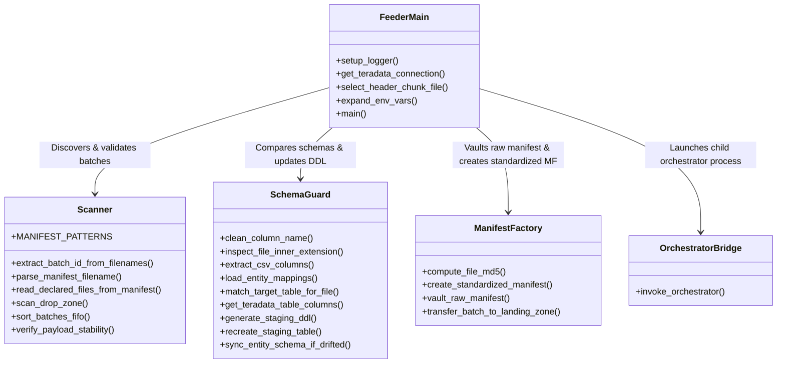

# BICC_INTAKE_CONTROLLER - Technical Manual & Codebase Inventory

## 1. Internal Architecture & Software Design

The **BICC_INTAKE_CONTROLLER** is structured as a modular Python package adhering to strict separation of concerns:

```
BICC_INTAKE_CONTROLLER/
├── feeder.py                     # Master Orchestration Supervisor & CLI Entrypoint
├── config.json                   # Runtime environment configuration
├── config_template.json          # Template configuration
├── entity_mapping.csv            # Entity routing rules
└── lib/                          # Specialized library modules
    ├── scanner.py                # Manifest discovery & file stability validation
    ├── schema_guard.py           # In-memory header streaming & DBC auto-DDL
    ├── manifest_factory.py       # Checksum generation, vaulting & atomic move
    └── orchestrator_bridge.py    # Subprocess execution & real-time log relay
```



---

## 2. Complete Module & Function Inventory

### 2.1 Entrypoint: `feeder.py`
- **Path**: `feeder.py`
- **Role**: Coordinates the end-to-end execution loop over the FIFO batch queue.
- **Imports**: `argparse`, `json`, `logging`, `os`, `sys`, `datetime`, `typing`, `teradatasql`, local `lib.*`.

#### Functions in `feeder.py`:
1. `setup_logger(logs_dir: str, source: Optional[str] = None) -> logging.Logger`
   - **Signature**: `setup_logger(logs_dir: str, source: Optional[str] = None) -> logging.Logger`
   - **Description**: Configures a dual-handler logger (`stdout` stream and timestamped file `LOG_FEEDER_<SOURCE>_<YYYYMMDD_HHMMSS>.log` inside `logs_dir/<SOURCE>/`). Sets level to `INFO` with standardized timestamp format.
   - **Side Effects**: Creates directory `logs_dir/<SOURCE>/` if absent; opens write file handle.

2. `get_teradata_connection(td_cfg: dict) -> teradatasql.TeradataConnection`
   - **Signature**: `get_teradata_connection(td_cfg: dict) -> teradatasql.TeradataConnection`
   - **Description**: Resolves host, user, and password parameters. First checks for `key_file`/`pass_file` explicitly; then checks `~/.dbt/<user>_Key.properties` and `Pass.properties`; then falls back to `TD_PASSWORD` or explicit password. Connects via `teradatasql.connect()`.
   - **Exceptions**: `ValueError` if host or user cannot be resolved; `teradatasql.OperationalError` if logon fails.

3. `select_header_chunk_file(file_list: List[str]) -> str`
   - **Signature**: `select_header_chunk_file(file_list: List[str]) -> str`
   - **Description**: Returns the file containing line 1 header in multi-chunk sets (uses deterministic alphabetical sorting `sorted(file_list)[0]`).
   - **Return**: Filename string.

4. `expand_env_vars(data: Any) -> Any`
   - **Signature**: `expand_env_vars(data)`
   - **Description**: Recursively traverses nested dictionaries, lists, and strings, resolving `$VAR` or `${VAR}` using `os.path.expandvars()`.

5. `main() -> None`
   - **Signature**: `main()`
   - **Description**: Parses CLI args, loads `config.json`, initializes logger, checks for in-flight recovery in `LOADING_ZONE/<SOURCE>`, scans `DROP_ZONE/<SOURCE>`, iterates over FIFO queue, triggers stability checks, invokes Schema Guard, vaults raw manifests into Batch Capsule `RAW/`, creates standardized manifest, transfers payload files to `LANDING_ZONE/<SOURCE>`, invokes Orchestrator, and evaluates return code under `FAIL_STOP`.

---

### 2.2 Module: `lib/scanner.py`
- **Path**: `lib/scanner.py`
- **Role**: Drop Zone discovery, manifest parsing, FIFO queue sorting, and upload stability sentry.

#### Functions in `lib/scanner.py`:
1. `extract_batch_id_from_filenames(declared_files: List[str]) -> Optional[str]`
   - **Description**: Scans payload names using regex `r"-batch([A-Za-z0-9_-]+?)-"` to recover missing batch IDs from files when omitted from the manifest title.

2. `parse_manifest_filename(filename: str, default_source: str = "ORACLE_FUSION") -> Dict`
   - **Description**: Tests filename against `MANIFEST_PATTERNS` regex suite. Extracts `source`, `extract_timestamp`, `batch_id`, and builds a composite `sort_key = (timestamp_float, batch_id)`.

3. `read_declared_files_from_manifest(manifest_path: str) -> List[str]`
   - **Description**: Parses content of raw manifest file. Handles commas, semicolons, and tabs. Skips comment lines (`#`), headers (`filename`), and configuration keys (`key=val`).

4. `scan_drop_zone(drop_zone_dir: str, default_source: str = "ORACLE_FUSION") -> List[Dict]`
   - **Description**: Discovers all `*.MF` files in the source partitioned drop zone `DROP_ZONE/<SOURCE>`. Files placed at the root of `DROP_ZONE/` are strictly ignored to prevent cross-source contamination. Reads declared files, refines batch ID and timestamps, and returns a list of batch metadata dictionaries.

5. `sort_batches_fifo(batches: List[Dict]) -> List[Dict]`
   - **Description**: Sorts batch dictionaries by `sort_key` in strict ascending chronological order.

6. `verify_payload_stability(drop_zone_dir: str, declared_files: List[str], settling_window_sec: int = 5) -> Tuple[bool, str]`
   - **Description**: Verifies that every manifested file exists, is non-zero in size, and records initial byte sizes. Sleeps for `settling_window_sec` seconds and checks that file sizes have not changed.
   - **Return**: `(is_stable: bool, message: str)`.

---

### 2.3 Module: `lib/schema_guard.py`
- **Path**: `lib/schema_guard.py`
- **Role**: In-memory header extraction, active keys support, DBC introspection, and automated NOPI DDL synchronization.

#### Functions in `lib/schema_guard.py`:
1. `clean_column_name(col_raw: str) -> str`
   - **Description**: Strips whitespace/quotes, transforms non-alphanumeric chars to `_`, deduplicates underscores, and casts to uppercase.

2. `inspect_file_inner_extension(file_path: str) -> str`
   - **Description**: Inspects archive contents without decompression. Returns `.pecsv` if archive contains active keys or `.csv` for standard payload.

3. `extract_csv_columns(file_path: str) -> List[str]`
   - **Description**: Streams the first line from `.zip` (via `zipfile.ZipFile`), `.gz` (via `gzip.open`), or uncompressed text. Detects delimiter (`;`, `\t`, `,`) and returns ordered list of cleaned column names.

4. `load_entity_mappings(mapping_file: str, filter_source: str = "ORACLE_FUSION") -> List[Dict]`
   - **Description**: Parses `entity_mapping.csv`, resolving `TARGET_TABLE`, `FILE_SIGNATURE`, `EXTENSION`, and `INNER_EXTENSION`.

5. `match_target_table_for_file(filename: str, mapping_rules: List[Dict], file_dir: str = None) -> Optional[str]`
   - **Description**: Matches file against signatures, outer extensions, and inner extensions.

6. `get_teradata_table_columns(connection, target_db: str, target_table: str) -> Optional[List[str]]`
   - **Description**: Queries Teradata system view `DBC.ColumnsV` ordered by `ColumnId`. Excludes `TECHNICAL_AUDIT_COLUMNS` (`INFA_BATCH_ID`, `INFA_LAST_REPLICATED`). Returns `None` if table does not exist.

7. `generate_staging_ddl(target_db: str, target_table: str, columns: List[str], default_type: str = "VARCHAR(4000)") -> str`
   - **Description**: Constructs DDL string for `CREATE MULTISET TABLE ... NO PRIMARY INDEX` with all payload columns typed as `VARCHAR(4000) CHARACTER SET UNICODE NOT CASESPECIFIC` and audit columns appended.

8. `recreate_staging_table(connection, target_db: str, target_table: str, columns: List[str], default_type: str = "VARCHAR(4000)")`
   - **Description**: Executes `DROP TABLE` followed by table creation using generated DDL.

9. `sync_entity_schema_if_drifted(...) -> Tuple[bool, str, List[str]]`
   - **Description**: Compares source CSV columns against Teradata table columns. If table missing $\rightarrow$ creates table (`CREATED`). If columns differ $\rightarrow$ drops and recreates table (`RECREATED`). If columns identical $\rightarrow$ no-op (`IDENTICAL`).

---

### 2.4 Module: `lib/manifest_factory.py`
- **Path**: `lib/manifest_factory.py`
- **Role**: Checksum generation, manifest standardization, and atomic ingress moves.

#### Functions in `lib/manifest_factory.py`:
1. `compute_file_md5(file_path: str) -> str`
   - **Description**: Computes MD5 checksum streaming in 64 KB blocks (`read(65536)`). Memory-safe for multi-gigabyte files.

2. `create_standardized_manifest(output_dir: str, source: str, extract_timestamp: str, batch_id: str, file_checksum_pairs: List[Tuple[str, str]]) -> str`
   - **Description**: Generates `MANIFEST_<SOURCE>_<EXTRACT_TIMESTAMP>_<BATCH_ID>.MF` containing CSV header `filename,checksum`.

3. `vault_raw_manifest(raw_manifest_path: str, archive_base_dir: str, source: str, extract_timestamp: str, batch_id: str, receipt_payload: List[Dict]) -> str`
   - **Description**: Vaults original BICC manifest into Batch Capsule `<archive_base_dir>/<SOURCE>/<YYYY-MM>/BATCH_<ID>_<TS>/RAW/` and writes canonical `RECEIPT_<SOURCE>_<EXTRACT_TS>_<BATCH_ID>.json` and legacy `intake_receipt.json`.

4. `transfer_batch_to_landing_zone(drop_zone_dir: str, landing_zone_dir: str, data_files: List[str], standardized_manifest_path: Optional[str] = None)`
   - **Description**: Moves all manifested data payload files from `DROP_ZONE/<SOURCE>` into `LANDING_ZONE/<SOURCE>`.

---

### 2.5 Module: `lib/orchestrator_bridge.py`
- **Path**: `lib/orchestrator_bridge.py`
- **Role**: Subprocess delegation and unbuffered real-time log streaming.

#### Functions in `lib/orchestrator_bridge.py`:
1. `invoke_orchestrator(orchestrator_dir: str, config_file: str = "config.json", python_bin: Optional[str] = None, env: Optional[Dict] = None) -> int`
   - **Description**: Spawns `<python_bin> orchestrator.py --config <config_file>` using `subprocess.Popen(bufsize=1, stdout=PIPE, stderr=STDOUT)`. Iterates over `readline` to relay output in real-time to the controller logger. Returns subprocess exit code.

---

## 3. Teradata System Catalog & Database Interactions

### 3.1 Metadata Query against `DBC.ColumnsV`
To inspect column schema without generating query overhead or table locks, Schema Guard queries the Teradata Data Dictionary:
```sql
SELECT TRIM(ColumnName)
FROM DBC.ColumnsV
WHERE DatabaseName = ?
  AND TableName = ?
ORDER BY ColumnId;
```

### 3.2 Automated NOPI Staging Table DDL Template
```sql
CREATE MULTISET TABLE {target_db}.{target_table} ,NO FALLBACK ,
     NO BEFORE JOURNAL,
     NO AFTER JOURNAL,
     CHECKSUM = DEFAULT,
     DEFAULT MERGEBLOCKRATIO
     (
         COL_1 VARCHAR(4000) CHARACTER SET UNICODE NOT CASESPECIFIC,
         COL_2 VARCHAR(4000) CHARACTER SET UNICODE NOT CASESPECIFIC,
         ...
         INFA_LAST_REPLICATED TIMESTAMP(0),
         INFA_BATCH_ID VARCHAR(100) CHARACTER SET UNICODE NOT CASESPECIFIC
     )
NO PRIMARY INDEX;
```
