# BICC_INTAKE_CONTROLLER - Testing, Validation & QA Guide

## 1. Testing Scope & Objectives

The testing framework for the **BICC_INTAKE_CONTROLLER** validates the ingress gateway's robustness under both normal operations and upstream failure scenarios.

### Validation Boundaries

```mermaid
flowchart LR
    subgraph Inputs["Test Vectors"]
        T1["Nominal CSV Batch"]
        T2["ZIP Archive Batch"]
        T3["Multi-Batch Simultaneous Arrival"]
        T4["Active Keys (.pecsv)"]
        T5["Unstable / In-Flight Upload"]
        T6["Zero-Byte / Truncated File"]
        T7["Upstream Schema Drift"]
    end

    subgraph Controller["BICC Intake Controller"]
        Sentry["Sentry & Scanner"]
        Guard["Schema Guard"]
        Vault["Vault & Transfer"]
    end

    subgraph ExpectedOutcomes["Verified Assertions"]
        A1["FIFO Chronological Queue Execution"]
        A2["Settling Sentry Abort (RC 1)"]
        A3["Auto-DDL Recreation (NOPI)"]
        A4["Pristine Vault + intake_receipt.json"]
        A5["Standardized Manifest in LANDING_ZONE"]
        A6["FAIL_STOP Halt on Downstream Error"]
    end

    Inputs --> Controller --> ExpectedOutcomes
```


---

## 2. Test Environment & Sandbox Setup

To run tests without impacting production or shared staging environments, use an isolated test directory tree:

```bash
# Create isolated test sandbox
export SANDBOX_DIR="/sg/local/sid/home/Dsidadm/DATA_LOADER/SANDBOX_TEST"
mkdir -p "${SANDBOX_DIR}/DATA/DROP_ZONE/ORACLE_FUSION"
mkdir -p "${SANDBOX_DIR}/DATA/LANDING_ZONE/ORACLE_FUSION"
mkdir -p "${SANDBOX_DIR}/DATA/LOADING_ZONE/ORACLE_FUSION"
mkdir -p "${SANDBOX_DIR}/DATA/ARCHIVE_ZONE/ORACLE_FUSION"
mkdir -p "${SANDBOX_DIR}/LOGS/ORACLE_FUSION"
mkdir -p "${SANDBOX_DIR}/CONFIG"

# Copy entity mapping
cp /sg/local/sid/home/Dsidadm/DATA_LOADER/CONFIG/entity_mapping.csv "${SANDBOX_DIR}/CONFIG/"
```

### Test Configuration (`test_config.json`)
```json
{
  "feeder": {
    "drop_zone": "/sg/local/sid/home/Dsidadm/DATA_LOADER/SANDBOX_TEST/DATA/DROP_ZONE",
    "raw_manifest_archive": "/sg/local/sid/home/Dsidadm/DATA_LOADER/SANDBOX_TEST/DATA/ARCHIVE_ZONE",
    "logs_dir": "/sg/local/sid/home/Dsidadm/DATA_LOADER/SANDBOX_TEST/LOGS",
    "batch_selection_policy": "FIFO_ALL",
    "on_batch_failure": "abort",
    "file_stability_window_seconds": 2,
    "source_system_code": "ORACLE_FUSION"
  },
  "schema_guard": {
    "auto_migrate_ddl": true,
    "default_column_type": "VARCHAR(4000)",
    "character_set": "UNICODE",
    "target_database": "${TDENV}SIDFINSTG",
    "entity_mapping_file": "/sg/local/sid/home/Dsidadm/DATA_LOADER/SANDBOX_TEST/CONFIG/entity_mapping.csv"
  },
  "orchestrator": {
    "orchestrator_dir": "../DATA_INGESTION_ORCHESTRATOR",
    "config_file": "config.json",
    "landing_zone": "/sg/local/sid/home/Dsidadm/DATA_LOADER/SANDBOX_TEST/DATA/LANDING_ZONE",
    "python_executable": "python3"
  },
  "teradata": {
    "host": "${TDPID}",
    "user": "${TDENV}${SID_ADM_USER}",
    "logmech": "TD2"
  }
}
```

---

## 3. Test Scenarios & Test Matrix

The following test suite reflects empirical validation performed across test batches 1 through 15:

| Test ID | Test Scenario | Input Dataset | Expected Result | Exit Code |
|---|---|---|---|:---:|
| **TC-FEED-01** | Nominal Single Batch CSV | `TEST_BATCH_1` | Batch ingested, vaulted, standardized manifest generated. | 0 |
| **TC-FEED-02** | Nominal Single Batch ZIP | `TEST_BATCH_12` | In-memory ZIP header streaming, full ingestion. | 0 |
| **TC-FEED-03** | Multi-Batch FIFO Queue | `TEST_BATCH_14_15_SIMULTANEOUS` | Oldest batch (14) completes before batch 15 starts. | 0 |
| **TC-FEED-04** | File Stability Sentry (Incomplete Transfer) | Growing file in `DROP_ZONE` | Detects size alteration, aborts under `FAIL_STOP`. | 1 |
| **TC-FEED-05** | Missing Data File | Manifest declares `fileA`, only `fileB` present | Detects missing file, aborts under `FAIL_STOP`. | 1 |
| **TC-FEED-06** | Zero-Byte File Arrival | 0-byte file in `DROP_ZONE` | Stability sentry flags empty file, aborts. | 1 |
| **TC-FEED-07** | Schema Drift (Added Column) | Sample CSV with new trailing column | Drops and recreates table with new column (NOPI). | 0 |
| **TC-FEED-08** | In-Flight Recovery | Pre-existing `.MF` in `LOADING_ZONE` | Bypasses `DROP_ZONE`, completes in-flight batch. | 0 |
| **TC-FEED-09** | Concurrency & Active Polling Wait | 2 concurrent feeder instances | Detects active PID, polls until lock released, avoids error 2652. | 0 |
| **TC-FEED-10** | Hybrid Decoupling (`--skip-post-tasks`) | Batch with `--skip-post-tasks` | Ingests data, skips all post-tasks, logs bypass trace. | 0 |
| **TC-FEED-11** | Multi-Source Partition Isolation | Simultaneous files in `DROP_ZONE/CRM` and `DROP_ZONE/ORACLE_FUSION` | Processes target partition only without touching other sources. | 0 |
| **TC-FEED-12** | Source Post-Tasks Execution & Skip | Batch 9006 (nominal) & Batch 9008 (`--skip-post-tasks`) | Merges & executes source tasks; cleanly skips all tasks when flag passed. | 0 |

> [!TIP]
> The automated Unix test suite in [`DATA_LOADER/TESTS/`](../../TESTS/README.md) validates all these scenarios end-to-end on Teradata Vantage with 100% automated pass verification (`./run_all_tests.sh`).

---

## 4. Detailed Test Procedures & Assertions

### Test Case: TC-FEED-03 (Multi-Batch FIFO Simultaneous Arrival)
- **Objective**: Verify that when multiple batches are deposited concurrently, the controller sorts them chronologically and processes them sequentially without violating single-batch boundaries.
- **Setup**:
  ```bash
  # Stage both batches simultaneously into DROP_ZONE
  cp /sg/local/sid/home/Dsidadm/DATA_LOADER/DATA/TEST_BATCH_14_15_SIMULTANEOUS/* \
     /sg/local/sid/home/Dsidadm/DATA_LOADER/SANDBOX_TEST/DATA/DROP_ZONE/
  ```
- **Execution**:
  ```bash
  python3 feeder.py --config /sg/local/sid/home/Dsidadm/DATA_LOADER/SANDBOX_TEST/test_config.json
  ```
- **Log Verification**:
  ```bash
  grep "Discovered 2 batch(es) in drop zone" /sg/local/sid/home/Dsidadm/DATA_LOADER/SANDBOX_TEST/LOGS/feeder_*.log
  grep "PROCESSING BATCH 1/2: ID=000000014" /sg/local/sid/home/Dsidadm/DATA_LOADER/SANDBOX_TEST/LOGS/feeder_*.log
  grep "PROCESSING BATCH 2/2: ID=000000015" /sg/local/sid/home/Dsidadm/DATA_LOADER/SANDBOX_TEST/LOGS/feeder_*.log
  ```
- **Filesystem Verification**:
  - `ARCHIVE_ZONE/ORACLE_FUSION/2026-10/BATCH_000000014_20261015_120014/RAW/` contains raw manifest and `RECEIPT_ORACLE_FUSION_...json` (and `intake_receipt.json`).
  - `ARCHIVE_ZONE/ORACLE_FUSION/2026-10/BATCH_000000015_20261015_120015/RAW/` contains raw manifest and `RECEIPT_ORACLE_FUSION_...json` (and `intake_receipt.json`).
  - `DROP_ZONE/ORACLE_FUSION` is empty at completion.

---

### Test Case: TC-FEED-07 (Schema Drift & Auto-DDL)
- **Objective**: Verify that Schema Guard detects added columns and executes `DROP TABLE` + `CREATE MULTISET TABLE ... NO PRIMARY INDEX`.
- **Setup**:
  1. Create a table with 3 columns in Teradata staging:
     ```sql
     CREATE MULTISET TABLE DEV0SIDFINSTG.ERP_MSH_USER (
         USER_ID VARCHAR(4000) CHARACTER SET UNICODE NOT CASESPECIFIC,
         USER_NAME VARCHAR(4000) CHARACTER SET UNICODE NOT CASESPECIFIC,
         INFA_LAST_REPLICATED TIMESTAMP(0),
         INFA_BATCH_ID VARCHAR(100) CHARACTER SET UNICODE NOT CASESPECIFIC
     ) NO PRIMARY INDEX;
     ```
  2. Drop an extract file containing 4 payload columns: `USER_ID`, `USER_NAME`, `EMAIL_ADDRESS`, `STATUS`.
- **Execution**:
  ```bash
  python3 feeder.py --config /sg/local/sid/home/Dsidadm/DATA_LOADER/SANDBOX_TEST/test_config.json
  ```
- **Log Verification**:
  ```bash
  grep "Schema drift detected!" /sg/local/sid/home/Dsidadm/DATA_LOADER/SANDBOX_TEST/LOGS/feeder_*.log
  grep "Successfully created NOPI staging table with 4 payload columns" /sg/local/sid/home/Dsidadm/DATA_LOADER/SANDBOX_TEST/LOGS/feeder_*.log
  ```
- **Database Assertion**:
  ```sql
  SELECT ColumnName FROM DBC.ColumnsV 
  WHERE DatabaseName = 'DEV0SIDFINSTG' AND TableName = 'ERP_MSH_USER' 
  ORDER BY ColumnId;
  ```
  Columns returned: `USER_ID`, `USER_NAME`, `EMAIL_ADDRESS`, `STATUS`, `INFA_LAST_REPLICATED`, `INFA_BATCH_ID`.

---

## 5. Automated Regression Test Script

A lightweight bash script can execute the entire test sequence:

```bash
#!/bin/bash
set -e

CONFIG_FILE="/sg/local/sid/home/Dsidadm/DATA_LOADER/SANDBOX_TEST/test_config.json"
FEEDER_DIR="/sg/local/sid/home/Dsidadm/DATA_LOADER/PROCESSING_TOOLS/BICC_INTAKE_CONTROLLER"

echo "=== Running BICC Intake Controller Regression Test Suite ==="

# Test 1: Empty Drop Zone (RC 0 expected)
python3 "${FEEDER_DIR}/feeder.py" --config "${CONFIG_FILE}"
echo "[PASS] Empty drop zone handled gracefully."

# Test 2: Multi-Batch Ingestion
cp /sg/local/sid/home/Dsidadm/DATA_LOADER/DATA/TEST_BATCH_12/* \
   /sg/local/sid/home/Dsidadm/DATA_LOADER/SANDBOX_TEST/DATA/DROP_ZONE/
python3 "${FEEDER_DIR}/feeder.py" --config "${CONFIG_FILE}"
echo "[PASS] Batch 12 processed and archived."

echo "=== All Controller Tests Passed Successfully ==="
```
